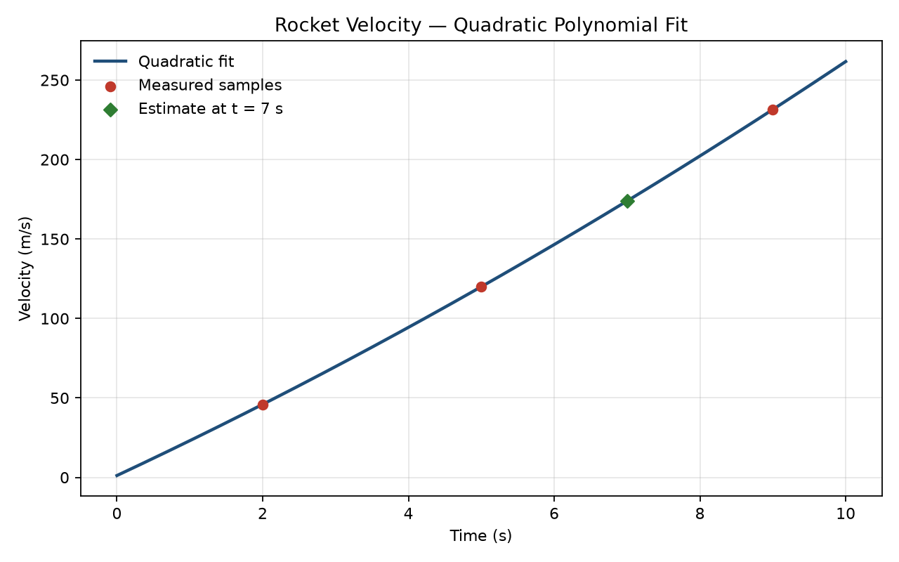

# Polynomial Fitting for Rocket Velocity

[](https://github.com/juandapradam12/Polynomial-Fitting-For-a-Rocket-Velocity/actions/workflows/ci.yml)

Portfolio use case: recover a continuous rocket velocity profile from three discrete measurements by fitting the unique quadratic interpolant

$$
v(t) = a_2 t^2 + a_1 t + a_0
$$

and solving the resulting Vandermonde system with Gauss–Jordan elimination (partial pivoting).



## Use case

| Item | Detail |
| --- | --- |
| **Domain** | Scientific computing / numerical methods |
| **Input** | Time–velocity samples at $t \in \{2, 5, 9\}\,\mathrm{s}$ |
| **Model** | Exact quadratic interpolant |
| **Solver** | Custom Gauss–Jordan on the augmented matrix |
| **Reference** | Cross-checked against `numpy.linalg.solve` |
| **Output** | Coefficients, $v(7\,\mathrm{s})$, residual / condition diagnostics, fit figure |

Measured samples:

$$
(t, v) = (2,\,45.948),\; (5,\,119.985),\; (9,\,231.497)
\quad [t] = \mathrm{s},\; [v] = \mathrm{m/s}.
$$

The linear system enforced by the interpolant is

$$
\begin{bmatrix}
t_i^2 & t_i & 1
\end{bmatrix}
\begin{bmatrix}
a_2 \\ a_1 \\ a_0
\end{bmatrix}
= v_i,
\quad i = 1,2,3.
$$

## Result snapshot

| Quantity | Value |
| --- | --- |
| $a_2, a_1, a_0$ | $0.457$, $21.480$, $1.160$ |
| $v(7\,\mathrm{s})$ | $173.913\,\mathrm{m/s}$ |
| Sample residual $\|r\|_2$ | $\sim 10^{-14}$ |
| $\kappa_2(A)$ | reported by the CLI |
| $\max\lvert\Delta a\rvert$ vs NumPy | $\sim$ machine epsilon |

## Project structure

```text
src/rocket_velocity/   # Installable package (models, solver, fitting, CLI)
scripts/run_fit.py     # Run without installing
tests/                 # Solver and fitting tests
docs/                  # Methodology and architecture
figures/               # Generated fit plot
.github/workflows/     # CI
```

See [docs/methodology.md](docs/methodology.md) for the mathematics (including conditioning and the NumPy cross-check) and [docs/architecture.md](docs/architecture.md) for the package layout.

## Quick start

```bash
python -m venv .venv
source .venv/bin/activate   # Windows: .venv\Scripts\activate
pip install -e ".[dev]"
python scripts/run_fit.py
pytest
```

Example CLI output shape:

```text
Quadratic model: v(t) = a2·t² + a1·t + a0
  a2 = ...
  a1 = ...
  a0 = ...
v(7 s) = ... m/s
Residual L2 norm at samples: ...
Design-matrix condition number κ₂(A): ...
Max |Δa| vs numpy.linalg.solve: ...
Figure written to: figures/rocket_velocity_fit.png
```

## Improvements over the legacy script

- Layered package (`models` → `solvers` → `fitting` → CLI/visualization) instead of a single procedural file
- Gauss–Jordan with **partial pivoting** and singular-system detection
- Condition-number reporting and coefficient cross-check vs `numpy.linalg.solve`
- Typed dataclasses, input validation, and residual reporting
- Automated tests and GitHub Actions CI
- English documentation with GitHub-renderable math

## Requirements

- Python 3.10+
- NumPy, Matplotlib (declared in `pyproject.toml`)

## License

MIT — see [LICENSE](LICENSE).
